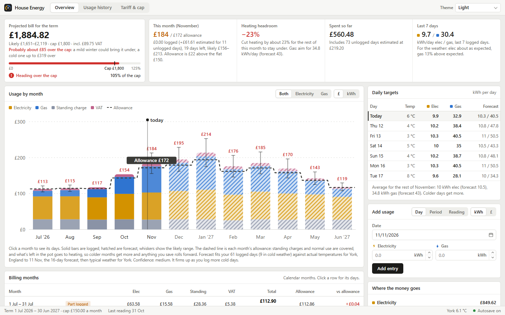

# House Energy Tracker

A small desktop app for renters on a capped energy bill. Log your gas and electricity (by the day, by
billing period or from meter readings) and it tells you whether you're on course to stay under the cap,
how much heating you have room for this month, and a daily kWh target for each fuel.



- Forecasts the rest of the term from your own usage and the weather where you live (actual temperatures,
  the 16-day forecast, then your town's typical weather), so colder months get more of the allowance.
- Caps per term, per month with carry-over, or per month with each month separate. Tariff changes,
  VAT and standing charges are all costed by day.
- Gas in kWh, m³ or ft³, with the calorific value from your bill.
- Start a new term when your tenancy renews, and look back at past terms.
- Export to CSV or a JSON backup, and import either.

It runs entirely on your computer. The only thing sent anywhere is your town's name and the term dates,
to [Open-Meteo](https://open-meteo.com/) for the weather (free, no account).

## Download

**Windows 10/11** (version 1.0.0):

- [**Installer**](https://github.com/Fin-engMech/house-energy-tracker/releases/download/v1.0.0/House-Energy-Tracker-Setup-1.0.0.exe) (recommended): adds a Start menu shortcut and an uninstaller
- [**Portable**](https://github.com/Fin-engMech/house-energy-tracker/releases/download/v1.0.0/House-Energy-Tracker-1.0.0-portable.exe): nothing to install, just run it

**macOS 11+** (Apple silicon and Intel): [**Disk image (.dmg)**](https://github.com/Fin-engMech/house-energy-tracker/releases/download/v1.0.0/House-Energy-Tracker-1.0.0.dmg)

**Linux** (x86-64, needs WebKitGTK 4.1): [**Program (.tar.gz)**](https://github.com/Fin-engMech/house-energy-tracker/releases/download/v1.0.0/House-Energy-Tracker-1.0.0-linux-x86_64.tar.gz)

Newer versions, when there are any, are on the [releases page](https://github.com/Fin-engMech/house-energy-tracker/releases/latest).

## Install

| System | How |
|---|---|
| Windows 10/11 | Run the installer. It installs for your user only, with no admin prompt. Or run the portable exe from anywhere (`--install` adds a Start menu shortcut for it). The window uses the Microsoft Edge WebView2 Runtime, which comes with Windows 11 and current Windows 10; the installer adds it if it's missing. The downloads aren't code-signed yet, so SmartScreen says "Windows protected your PC": choose **More info › Run anyway**. |
| macOS 11+ | Open the `.dmg` and drag **House Energy Tracker** onto the Applications folder beside it. The download isn't notarised yet, so macOS refuses to open it the first time: open **System Settings › Privacy & Security** and choose **Open Anyway**. |
| Arch Linux | `cd packaging/arch && makepkg -si` |
| Other Linux | Unpack the `.tar.gz` (or build it, below), then run `./energy-tracker --install` to add it to your app menu. It needs WebKitGTK 4.1 (`webkit2gtk-4.1` / `libwebkit2gtk-4.1-0`), which most desktops already have. |

The first time it opens, it asks for your term dates, cap, tariff and town. Everything can be changed
later under **Tariff & cap**.

## Where your data is kept

| | Linux | macOS | Windows |
|---|---|---|---|
| Data | `~/.local/share/house-energy-tracker/` | `~/Library/Application Support/House Energy Tracker/` | `%APPDATA%\House Energy Tracker\` |
| Weather cache and log | `~/.cache/house-energy-tracker/` | `~/Library/Caches/House Energy Tracker/` | `%LOCALAPPDATA%\House Energy Tracker\Cache\` |
| Exports | your Downloads folder | `~/Downloads` | `%USERPROFILE%\Downloads` |

Your data is `energy-data.json`, saved on every change. The previous save is kept as `energy-data.json.bak`,
and the app loads that automatically if the main file is ever damaged. **Tariff & cap › Your data** shows
the file and can open its folder. To use a different file, start the app with `--data path/to/file.json`.

Uninstalling leaves your data in place.

## Build from source

You need [Rust](https://rustup.rs/) (stable) and, on Linux, the GTK 3 and WebKitGTK 4.1 development
packages. On Windows, see the MSVC note below.

```sh
cargo build --release          # target/release/energy-tracker (.exe on Windows)
cargo test
```

Packages:

- **Windows**: the exe must be built with the **MSVC** toolchain. A `windows-gnu` build links WebView2 as a
  separate `WebView2Loader.dll` and won't start without it, so `build.rs` refuses to make a GNU release.
  - On Windows: install [Visual Studio Build Tools](https://visualstudio.microsoft.com/visual-cpp-build-tools/)
    with the "Desktop development with C++" workload, then
    `rustup target add x86_64-pc-windows-msvc` and `cargo build --release --locked --target x86_64-pc-windows-msvc`.
  - From Linux: `cargo install cargo-xwin`, then `cargo xwin build --release --locked --target x86_64-pc-windows-msvc`
    (it downloads Microsoft's CRT and SDK libraries and needs clang and lld).
  - Then `iscc packaging\windows\installer.iss` ([Inno Setup](https://jrsoftware.org/isinfo.php) 6.3 or later)
    writes `dist\House-Energy-Tracker-Setup-x.y.z.exe`. It takes the version from the exe.
  - The C runtime is linked in statically (`.cargo/config.toml`), so the exe needs no Visual C++ Redistributable.
- **macOS**: `packaging/macos/make-app.sh` builds a universal `.app` and `.dmg` in `dist/` (see Signing).
- **Arch Linux**: `packaging/arch/PKGBUILD`.

The version number lives only in `Cargo.toml`; the installer, the macOS bundle and the Arch package read it from there.

### Releases

GitHub Actions builds every download. `ci.yml` runs the tests on Windows, macOS and Linux for each push.
`release.yml` runs when a version tag is pushed: it builds the Windows installer and portable exe, the macOS
`.dmg` and a Linux `.tar.gz`, and attaches them to the release (creating it if needed). To release:

```sh
# after changing version in Cargo.toml and committing
git tag v1.1.0
git push origin main v1.1.0
```

The tag must match the version in `Cargo.toml`. To add the files to an existing release, run the
**Release** workflow from the Actions tab and give it the tag.

### Signing (before giving it to other people)

Unsigned builds work, but Windows and macOS warn about them (see Install).

- **Windows**: with a code-signing certificate, sign the exe, installer and uninstaller in one step
  (in PowerShell; the single quotes keep `$f`, which Inno Setup replaces with each file's name):

  ```
  iscc /DSign '/Ssigntool=signtool sign /fd sha256 /tr http://timestamp.digicert.com /td sha256 /a $f' packaging\windows\installer.iss
  ```

  `signtool` comes with the Windows SDK (installed with the Build Tools). `/a` picks your certificate from
  the certificate store; use `/f cert.pfx /p <password>` for a file instead.
- **macOS**: with an Apple Developer ID, save your notarisation login once with
  `xcrun notarytool store-credentials het-notary`, then run
  `SIGN_IDENTITY="Developer ID Application: <Name> (<TEAMID>)" NOTARY_PROFILE=het-notary packaging/macos/make-app.sh`.
  This signs with the hardened runtime, notarises the `.dmg` and staples the ticket. The bundle identifier
  is `BUNDLE_ID` in `src/main.rs`.

`packaging/make-icons.sh` regenerates the bitmap icons in `assets/` from `icon.svg`.
`packaging/cross-check.sh` type-checks the Windows and macOS builds from Linux.

## Command line

```
energy-tracker [--data FILE] [--port PORT] [--install] [--uninstall]
               [--no-window] [--browser] [--safe-render] [--version]
```

- `--install` / `--uninstall` adds or removes the app-menu entry (Linux), the Start menu shortcut
  (Windows) or `~/Applications/House Energy Tracker.app` (macOS).
- `--browser` opens it in your web browser instead of its own window.
- `--safe-render` turns off GPU rendering on Linux, for a blank window on some graphics drivers.

The app serves its page on `127.0.0.1` only (port 47615 by default), and opening it again while it's
running just opens another window.

## Licence

MIT: see [LICENSE](LICENSE). Weather data comes from [Open-Meteo](https://open-meteo.com/) under
[CC BY 4.0](https://creativecommons.org/licenses/by/4.0/).
